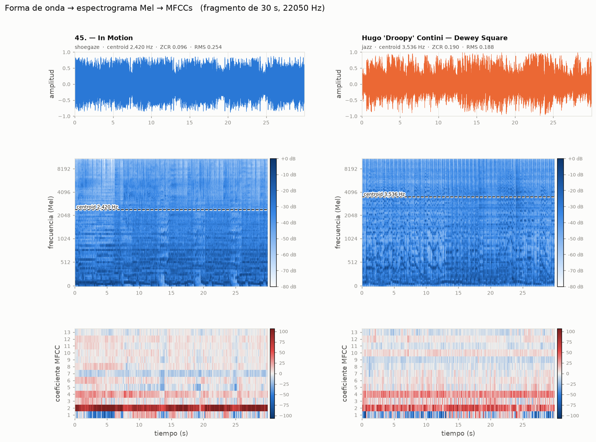
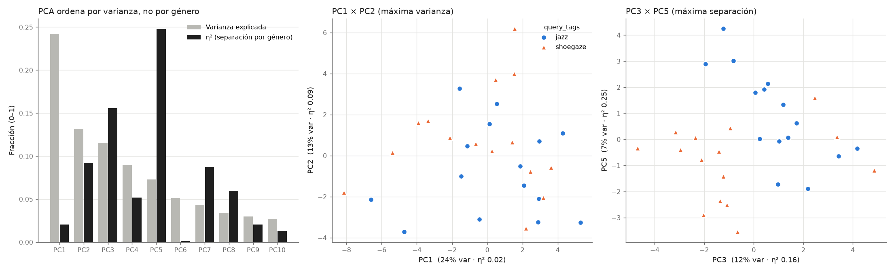
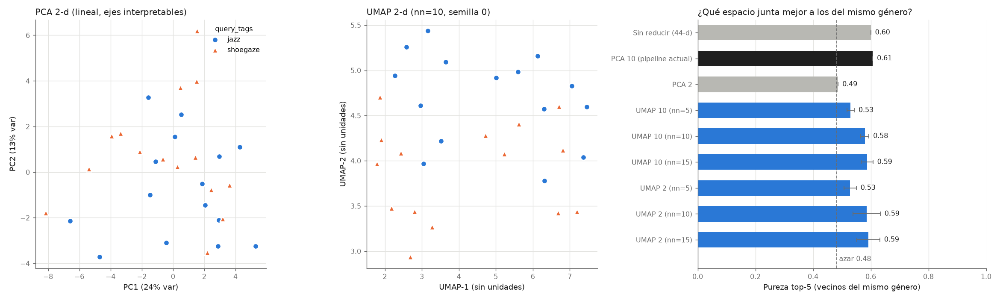

# Motor de Similitud Acústica

Sistema de recomendación de música basado en el **contenido acústico crudo**
(Audio Content-Based Filtering), **no** en comportamiento de usuarios ("los que
escucharon X también escucharon Y"). Analiza el audio de cada track con
[Librosa](https://librosa.org/) y usa Scikit-learn para encontrar canciones con
textura sonora, tempo y color parecidos, sin mirar género, artista ni época.

Nace como proyecto de aprendizaje personal de Data Science + procesamiento de
señales aplicado a audio, y se publica abierto por si le sirve a alguien más.
El foco está en **entender por qué funciona cada paso**, así que el código está
comentado con esa intención.

**Estado:** MVP funcional sobre un catálogo de prueba de 30 tracks
(15 *shoegaze* + 15 *jazz*, Creative Commons, de Jamendo).

## Pipeline

```
Jamendo API ──► mp3 ──► 44 features por track ──► StandardScaler ──► PCA(10) ──► coseno ──► top-k vecinos
 fetch_jamendo.py       extract_features.py        └──────────── similarity.py ─────────────┘
```

| Script | Qué hace |
|---|---|
| `src/fetch_jamendo.py` | Descarga tracks con licencia CC desde la [API de Jamendo](https://developer.jamendo.com/). Guarda `metadata.json` con el tag de búsqueda de cada track, que se usa como etiqueta de validación y **nunca** entra al modelo. |
| `src/extract_features.py` | Calcula 44 features por track: 13 MFCCs (media + desvío), 12 chroma, spectral centroid y rolloff, zero-crossing rate, tempo y RMS. |
| `src/similarity.py` | Escala, reduce con PCA y busca los vecinos más cercanos por similitud coseno. |
| `src/visualize_track.py` | Muestra qué miden las features: forma de onda, espectrograma Mel y MFCCs de dos tracks lado a lado. |
| `src/diagnose_pca.py` | Diagnostica el espacio PCA: loadings, qué componentes separan géneros (η², d de Cohen) y pureza de vecinos contra el azar. |
| `src/compare_reduction.py` | Compara PCA contra UMAP por pureza de vecinos y trustworthiness, con varias semillas. |

## Resultados

### 1. La hipótesis "sucio vs limpio" no se cumplió

Antes de correr nada, la hipótesis era que el shoegaze (guitarras saturadas)
iba a separarse trivialmente del jazz por tener más energía en agudos
(spectral centroid y ZCR altos). **No pasó:** el centroid medio es casi igual
(shoegaze 1938 Hz, jazz 1993 Hz). El "jazz" de Jamendo incluye nu-jazz,
trip-hop y bebop con platillos, que generan tanto brillo como una guitarra
distorsionada.

Lo que sí distingue a los géneros es la **variabilidad del timbre en el
tiempo**: el "muro de sonido" del shoegaze es estático, y el jazz cambia de
textura todo el tiempo.



### 2. PCA maximiza varianza, no separación de géneros

La componente que mejor separa géneros es la PC5 (d de Cohen = 1.11) y explica
solo el 7% de la varianza. PCA no es supervisado y no sabe qué es un género.



### 3. PCA vs UMAP: con 30 tracks, UMAP no mejora

| Espacio | Pureza top-5 | Trustworthiness |
|---|---|---|
| Sin reducir (44-d) | 0.60 | 0.941 |
| **PCA 10 (pipeline actual)** | **0.61** | 0.923 |
| PCA 2 | 0.49 | 0.833 |
| UMAP 10 (n_neighbors=10) | 0.58 ± 0.01 | **0.956** ± 0.004 |
| UMAP 2 (n_neighbors=10) | 0.59 ± 0.05 | 0.933 ± 0.014 |
| Azar | 0.48 | — |

*Pureza top-5:* fracción de los 5 vecinos más cercanos que comparten género.
*Trustworthiness:* qué tan fiel es el espacio reducido a los vecindarios del
espacio original (1 = perfecto). UMAP: media ± desvío sobre 10 semillas.



Lecturas:

- **Hay señal, pero modesta.** Todos los espacios razonables quedan alrededor
  de 0.60 de pureza, contra 0.48 al azar.
- **UMAP conserva mejor los vecindarios** (mayor trustworthiness), pero eso no
  se traduce en vecinos más del mismo género. El cuello de botella está en las
  features, no en la reducción.
- **PCA a 2 dimensiones destruye la señal**: queda al nivel del azar. Lo que
  separa géneros vive en componentes de baja varianza.
- **UMAP en 2-d es inestable entre semillas** (±0.05) y sensible a
  `n_neighbors`. Con `n_neighbors=5` el grafo es demasiado local para 30
  puntos. Sus ejes no tienen unidades, así que el scatter sirve para mirar,
  no para interpretar distancias.
- **Decisión:** el recomendador sigue con PCA(10). Rinde igual, es
  determinístico, más rápido e interpretable vía loadings. UMAP vale la pena
  revisarlo con un catálogo más grande, donde la estructura no lineal tiene más
  chances de aparecer.

## Uso

Requiere Python 3.13. Con 3.14, numba (dependencia de librosa y umap) todavía
puede no tener soporte.

```bash
python -m venv .venv
source .venv/Scripts/activate        # Windows (Git Bash); en Linux/macOS: .venv/bin/activate
pip install -r requirements.txt

# 1. Conseguir un client_id gratis en https://developer.jamendo.com/v3.0
#    y guardarlo en un .env en la raíz (JAMENDO_CLIENT_ID=...), o pasarlo con --client-id.
#    Una corrida por género; el metadata.json se acumula entre corridas.
python src/fetch_jamendo.py --tags shoegaze --n 15
python src/fetch_jamendo.py --tags jazz --n 15

# 2. Extraer features acústicas
python src/extract_features.py

# 3. Buscar tracks similares
python src/similarity.py --query "nombre del track o artista" --top 5

# 4. Diagnóstico y comparación (figuras en outputs/)
python src/visualize_track.py --tracks "In Motion" "Dewey Square"
python src/diagnose_pca.py
python src/compare_reduction.py
```

El audio descargado y las features no se versionan (ver `.gitignore`). Cada
quien arma su catálogo con su propio `client_id`.

## Decisiones de diseño

- **Escalar antes de PCA es obligatorio.** Las features viven en escalas muy
  distintas (chroma entre 0 y 1, spectral rolloff en miles de Hz). Sin
  `StandardScaler`, las de mayor magnitud dominan la varianza sin que eso tenga
  que ver con similitud musical. No tira error, solo da resultados malos.
- **Agregación estadística, no series temporales.** Cada feature se resume en
  media (y desvío, para los MFCCs) a lo largo del track. Así cada track es un
  vector de tamaño fijo, sin importar cuánto dure.
- **Coseno, no euclidiana**, en el espacio PCA. Compara la "dirección" del
  perfil sonoro más que su magnitud. En UMAP se usa euclidiana, porque ahí el
  origen de coordenadas no significa nada.
- **El género solo valida.** Las columnas de metadata (`query_tags`, `genre`,
  etc.) están excluidas explícitamente del vector de features.

## Limitaciones conocidas

- El catálogo es chico (30 tracks). Todos los números de arriba tienen mucha
  varianza muestral.
- El tempo de `librosa.beat.beat_track()` es poco confiable en jazz con swing o
  ritmo libre. Es una limitación conocida de MIR, no un bug.
- Los tags de Jamendo son ruidosos: "jazz" incluye cosas muy distintas entre sí.

## Roadmap

- [x] Visualización pedagógica de forma de onda / espectrograma / MFCCs
- [x] Diagnóstico de PCA (loadings, separación por género, pureza de vecinos)
- [x] Comparación PCA vs UMAP
- [ ] Tests
- [ ] Clustering (KMeans / HDBSCAN) para explorar agrupaciones naturales
- [ ] Agregación de features a nivel álbum
- [ ] Anomaly detection: tracks "raros" dentro de su propio género declarado
- [ ] Ampliar el catálogo (más géneros, más tracks)

## Licencia

Código bajo [MIT](LICENSE). El audio de Jamendo tiene sus propias licencias
Creative Commons por track y no se redistribuye en este repo.

## Stack

Python 3.13 · Librosa · Scikit-learn · UMAP · Pandas · NumPy · matplotlib
